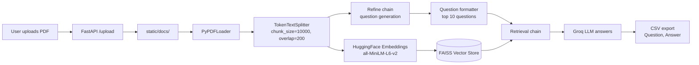

#  Interview Question Creator

An end-to-end **RAG (Retrieval-Augmented Generation)** application that turns any PDF document into a ready-to-use **Q&A set**. Upload a document (resume, lecture notes, research paper, report…) and the app generates exam-style questions from it, then answers each question **grounded only in the document content**.

Built with **LangChain**, **FAISS** (vector database), **HuggingFace embeddings**, **Groq LLM** and a **FastAPI + Jinja2** web interface.

> Example: upload a CV → get 10 interview questions with answers, exported as a downloadable CSV.

---

##  Features

- 📄 **PDF upload & preview** directly in the browser
- 🧠 **Automatic question generation** using a `refine` summarization chain (multi-chunk, long documents supported)
- 🔍 **Retrieval-Augmented answers** — questions are answered by retrieving the most relevant chunks from a FAISS vector store
- 🚫 **Grounded answers only** — the prompt forbids outside knowledge and returns *"I don't know based on the provided context."* when the document has no answer
- ⚡ **Fast inference** via Groq's LLM API
- 📥 **CSV export** (`Question`, `Answer`) ready for download
- 🎨 Simple Bootstrap-based UI with loading state and error handling

---

## 🏗️ Architecture



**Pipeline (`src/helper.py`)**

1. **Load** – `PyPDFLoader` reads every page of the PDF.
2. **Split** – `TokenTextSplitter` chunks the text (10k tokens, 200 overlap).
3. **Generate questions** – a LangChain `refine` chain (`load_summarize_chain`) produces questions from the chunks using `prompt_template` / `refine_template`.
4. **Format** – the raw text is split on `?` and trimmed to the 10 best questions.
5. **Index** – the document chunks are embedded with `all-MiniLM-L6-v2` and stored in **FAISS**.
6. **Answer** – `create_retrieval_chain` + `create_stuff_documents_chain` retrieves relevant chunks and answers each question with `chain_prompt` (context-only answering).
7. **Export** – results are written to a CSV file and streamed back to the UI.

---

## 🧰 Tech Stack

| Layer | Technology |
| --- | --- |
| Web framework | FastAPI, Uvicorn |
| Templating / UI | Jinja2, Bootstrap 5, jQuery, SweetAlert2 |
| Orchestration | LangChain (`langchain`, `langchain-core`, `langchain-community`, `langchain-classic`) |
| LLM | Groq API — `openai/gpt-oss-20b` via `langchain-groq` |
| Embeddings | HuggingFace `sentence-transformers/all-MiniLM-L6-v2` |
| Vector database | FAISS (`faiss-cpu`) |
| PDF parsing | `pypdf`, `PyPDF2` |
| Config | `python-dotenv` |
| Async I/O | `aiofiles` |

---

## 📂 Project Structure

```
interview_question/
├── app.py                  # FastAPI app: /, /upload, /analyze
├── setup.py                # Local package definition
├── requirements.txt
├── .env.example            # Copy to .env and add your keys (not committed)
├── data/                   # Sample PDFs used for experiments
├── research/
│   └── expriment.ipynb     # Notebook used to prototype the pipeline
├── src/
│   ├── config.py           # Loads GROQ_API_KEY from .env
│   ├── models.py           # LLM + embeddings initialization
│   ├── prompt.py           # Question-generation & answering prompts
│   ├── helper.py           # RAG pipeline (load → split → generate → index → answer)
│   ├── vec_db.py           # FAISS vector store builder
│   └── test.py             # Scratch script
├── static/
│   ├── docs/               # Uploaded PDFs land here (runtime, git-ignored)
│   └── output/             # Generated CSV output (runtime, git-ignored)
└── templates/
    └── index.html          # Single-page UI
```

---

## 🚀 Getting Started

### Prerequisites

- Python **3.10+**
- A free **Groq API key** → <https://console.groq.com/keys>
- ~2 GB free disk space (the embedding model is downloaded on first run)

### 1. Clone the repository

```bash
git clone https://github.com/<your-username>/interview_question.git
cd interview_question
```

### 2. Create a virtual environment

```bash
# Windows (PowerShell)
python -m venv .venv
.\.venv\Scripts\Activate.ps1

# macOS / Linux
python3 -m venv .venv
source .venv/bin/activate
```

### 3. Install dependencies

```bash
pip install --upgrade pip
pip install -r requirements.txt
```

### 4. Configure environment variables

Create a `.env` file in the project root:

```env
GROQ_API_KEY=your_groq_api_key_here
```

> ⚠️ Never commit `.env` — it is already excluded by `.gitignore`.

### 5. Run the app

```bash
uvicorn app:app --reload
```

Open <http://127.0.0.1:8000> in your browser.

---

## 🖱️ Usage

1. Click **Choose file** and pick a PDF (keep it small — ~5 pages is the sweet spot for latency and cost).
2. Press **Generate Q&A**.
3. The PDF is previewed on the left while the pipeline runs on the right.
4. When finished, click the download button to get the **CSV** of questions and answers.

**Sample output**

| Question | Answer |
| --- | --- |
| What is the main objective of the project? | According to the document, … |
| Which technologies were used? | … |

---

## 🔌 API Endpoints

| Method | Endpoint | Body | Description |
| --- | --- | --- | --- |
| `GET` | `/` | – | Renders the upload page |
| `POST` | `/upload` | `pdf_file` (file), `filename` (string) | Saves the PDF to `static/docs/` and returns its path |
| `POST` | `/analyze` | `pdf_filename` (string) | Runs the RAG pipeline and returns the generated CSV path |

<details>
<summary>Example: upload with cURL</summary>

```bash
curl -X POST http://127.0.0.1:8000/upload \
  -F "pdf_file=@data/SDG.pdf" \
  -F "filename=SDG.pdf"

# → {"msg":"success","pdf_filename":"static/docs/SDG.pdf"}

curl -X POST http://127.0.0.1:8000/analyze \
  -F "pdf_filename=static/docs/SDG.pdf"
```

</details>

---

## ⚙️ Configuration

| Variable | Where | Description |
| --- | --- | --- |
| `GROQ_API_KEY` | `.env` | Groq API key used by `ChatGroq` |

Tunable parameters live in the source:

- `src/models.py` → `model`, `temperature` (default `0.3`)
- `src/helper.py` → `chunk_size=10000`, `chunk_overlap=200`
- `src/helper.py` → `question_formater()` caps output at **10 questions**

---

## ⚠️ Known Limitations

- Long PDFs (100+ pages) are slow and expensive: question generation calls the LLM once per chunk.
- Only the first **10** questions are kept.
- No authentication, rate limiting, or persistent storage — this is a demo/portfolio project, not a production service.
- Uploaded files stay on disk under `static/docs/` and are not cleaned automatically.


---

## 🤝 Contributing

Contributions are welcome:

1. Fork the repository
2. Create a branch: `git checkout -b feature/my-feature`
3. Commit your changes: `git commit -m "Add my feature"`
4. Push: `git push origin feature/my-feature`
5. Open a Pull Request

---

## 📄 License

Distributed under the **MIT License**. See `LICENSE` for more information (add one if it's missing).

---

## 👤 Author

**Imad Kasse**
- GitHub: [@imadkasse](https://github.com/imadkasse)
- Email: kasseimad81@gmail.com

---

⭐ If this project helped you, consider giving it a star!
